# Future Cup 多 Agent 前端工程平台初赛方案书

## 文档信息

| 项目 | 内容 |
|---|---|
| 文档版本 | 初赛方案书 v1.0 |
| 完成日期 | 2026-11-03 |
| 系统基线 | `main / f50c1ce2c6e6e08324a4addde64178ba89ba6c62` |
| 产品定位 | 面向 Web 前端工程交付的多 Agent 编排、验证与自愈平台 |
| 初赛状态 | M1-M5.5 完成，M5.6 材料整理中 |
| 核心证据 | 真实 DeepSeek 七人团队 E2E、管理平台浏览器验收、202/34/91 聚焦测试、10/10 构建门禁 |

## 摘要

Future Cup 是一个面向 Web 前端工程交付的多 Agent 编排与自验证平台。用户使用自然语言描述前端需求后，系统会进行需求理解、页面规划、任务 DAG 构建、Agent 团队装配、并发任务调度、代码生成、工程集成、真实浏览器验证和有限轮次的自动修复，最终交付一个可运行、可验证、带执行证据的 React 工程。

项目没有从零重复实现 Agent Runtime。底层使用 DeepSeek Harness 的 Agent、Session、模型适配、工具与事件能力，Cordis 负责插件组合和应用生命周期；Future Cup 自主研发平台控制层，包括持久任务 DAG、可解释调度、Agent Registry、不可变团队版本、项目团队冻结、工作流控制图、自适应 Self-loop、事务事件、Outbox、运行租约和交付界面。

本项目的核心价值不是“单次生成一个网页”，而是让多个具有不同职责的 Agent 在可审计约束下协作，并用独立验证器确认生成结果。模型的自然语言结论不能替代执行证据；只有工程结构、TypeScript、Vite、Playwright、控制台、网络和截图检查通过后，系统才允许进入交付。

最终真实 E2E 已证明完整闭环：系统冻结一个已发布的七人团队，建立 7 个独立 Harness Home，产生 6 个生成 Session，完成 5/5 个任务；随后注入 TypeScript 契约错误，选择 `typescript-contract` 修复策略，产生 1 个独立 Repair Session，并完成 `FAIL → PASS` 复验。最终运行状态为 `PASSED`，4/4 个桌面和移动浏览器检查通过。

## 1. 选题背景与场景需求分析

### 1.1 选题背景

大模型已经能够根据自然语言生成代码，但一次性生成前端工程仍面临明显问题：模型输出具有随机性，长任务容易中断，代码可能能构建却不满足交互需求，失败后通常只能重新生成，缺少稳定的团队协作、调度、验证和恢复机制。单 Agent 串行完成任务也难以体现多 Agent 系统应有的动态分工、并行执行和反馈闭环。

本项目选择“前端工程交付”而不是“通用网页生成”，原因是前端工程同时具备可运行构建、真实浏览器交互、截图和网络证据等可验证结果，适合证明 Agent 的代码生成能力、协作能力和自愈能力。React、TypeScript、Vite 和 Ant Design 提供稳定的工程边界，能够在初赛阶段集中证明系统完成度，而不是把资源分散到多种技术栈和业务后端。

### 1.2 目标用户与使用场景

目标用户是希望快速搭建前端原型的个人开发者、学生团队和产品验证人员。用户只需要描述页面目标、功能范围和交互要求，不需要手工拆分 Agent、任务或 DAG。平台将自然语言需求转化为可执行计划，并在项目管理界面中展示 Agent、任务、调度、验证和修复过程。

典型场景包括：生成一个带总览页和用户管理页的后台管理台；生成一个包含导航和搜索交互的响应式页面；生成一个已经存在的项目修订，并通过故障注入验证平台是否能够发现问题、定位源码、执行修复和重新验证。

### 1.3 产品问题定义

平台重点解决以下问题：

- 将模糊需求转化为显式的页面、任务、依赖和验收条件。
- 让不同角色 Agent 使用独立上下文和受限工具执行，减少职责混乱。
- 将任务状态、调度理由、Session、验证和修复记录持久化，避免结果只存在于模型上下文中。
- 使用确定性验证和独立浏览器证据判断成功，避免模型“自称完成”。
- 在失败后执行有限轮次修复，重复失败或环境不完整时明确升级，不无限重试。
- 让用户可以发布、克隆和管理自己的团队版本，并在项目启动时冻结该版本，保证运行可复现。

### 1.4 初赛范围与边界

初赛版本支持 React、TypeScript、Vite 和 Ant Design；支持受控 Agent 角色、受控工具、固定工作流结构和版本化团队。系统不生成业务后端，不提供任意 Agent 市场、任意工具安装、完整拖拽工作流编辑器、多租户和计费。

RAG、MCP 和压力测试放到决赛。初赛材料中只说明技术边界和后续计划，不把未实现能力写成已完成能力。Docker 与 SWE-ReX 已经完成独立技术验证，但容器隔离尚未接入主运行链路，当前初赛版本面向受控本地演示环境。

## 2. 平台总体架构设计与技术选型说明

### 2.1 总体架构

系统由控制面、执行面和展示面组成。控制面负责项目、团队、任务、调度、验证和修复；执行面由 DeepSeek Harness 为每个 Agent 提供独立 Runtime 和 Session；展示面通过 React 管理端、Socket.IO 和 HQ 大屏呈现真实状态。

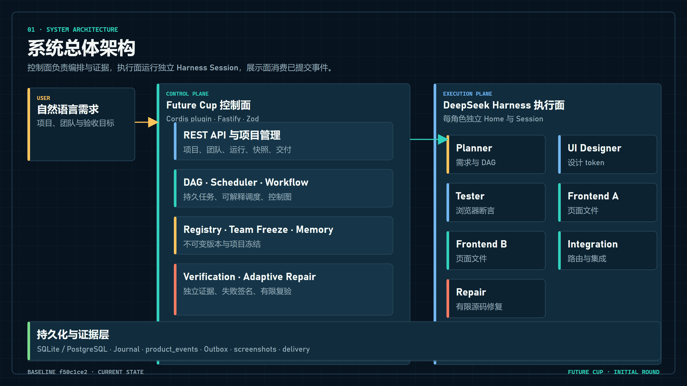

控制面由两个自研包组成。`future-cup-orchestration` 负责领域逻辑和持久化抽象，`future-cup-platform` 负责 Fastify API、Socket.IO、Outbox、SQLite/PostgreSQL 适配、真实团队启动和静态界面。Cordis profile 将两个包与 DeepSeek Harness 组合成可启动应用。

### 2.2 技术选型说明

Harness 原生 Workflow 具备脚本、并行和子 Agent 调用能力，但缺少持久任务 DAG、任务 revision、Journal、恢复和可解释调度，因此不适合作为平台权威任务状态。项目最终采用“Harness + 自研轻量 DAG”的结构，Harness 负责单个 Agent 的执行，平台负责多 Agent 的控制和证据。

LangGraph.js 暂不引入。其图状态和 checkpoint 生态成熟，但会与 Harness Session、平台 DAG 和工作流控制形成多个生命周期真源。在初赛阶段，自研轻量 DAG 已能证明完整闭环，继续引入第二个工作流引擎会增加迁移、调试和许可证披露成本。

后端采用 Fastify、TypeScript 和 Zod。Fastify 负责 REST 和静态资源托管，Zod 负责请求、Agent 输出、产品事件和持久化 JSON 校验。Socket.IO 负责实时项目事件，Outbox 保证事件在数据库事务中与领域状态一起提交。

存储层同时支持 SQLite 和 PostgreSQL。SQLite 用于本地运行和确定性测试，PostgreSQL 使用 Prisma 和正式 migration，用于更接近生产环境的持久化。两种适配器共享 `OrchestrationStore` 抽象，避免业务逻辑直接依赖具体数据库。

前端采用 React 18、TypeScript、Vite、Ant Design、React Router、React Flow 和 Socket.IO Client。HashRouter 保证生成工程可以在静态预览环境中工作；React Flow 用于可视化 DAG 和工作流控制图。

### 2.3 执行模型与安全边界

每个 Agent 使用独立 `DeepSeekHarness`、独立 Session 和独立 DSH Home。默认模型路由为 `deepseek-official / deepseek-flash`，默认关闭 reasoning，单 Agent 最大输出为 32,000 token，单次请求超时为 600 秒。

Agent 暴露的工具只有 `read`、`read_image` 和 `working_directory`。Bash、PowerShell、文件写入和文件编辑被禁用。模型返回的是结构化文件计划，最终落盘由平台执行，并限制在任务声明的 `src/` 范围内。

需要明确的是，当前受限工具不等于完整容器隔离。平台仍在本机工作区执行 `npm install`、TypeScript、Vite 和 Playwright。Docker 和 SWE-ReX 只在 M1 独立验证了文件、网络、CPU、内存、PID 和容器回收能力，尚未接入主运行链路。该限制必须在方案和演示中如实说明。

## 3. Agent 角色定义、工作流设计与编排逻辑详解

### 3.1 Agent 角色

系统包含七类受控 Agent：

| Agent | 输入 | 职责 | 输出 |
|---|---|---|---|
| Planner | 用户需求 | 分析页面、约束和依赖，生成 DAG | 页面计划、任务、依赖、能力要求 |
| UI Designer | 需求与页面 | 定义共享视觉和响应式规范 | 设计说明、颜色、字体、间距 token |
| Tester | 需求、页面、设计 | 生成确定性浏览器验收规格 | 路由、文本、导航交互 |
| Frontend | 页面、设计、Tester 断言 | 实现单个页面 | 最多 3 个页面文件 |
| Integration | 页面输出、验收规格 | 集成导航、路由和共享组件 | 最多 8 个 `src/` 文件 |
| Verifier | 工程和 Tester 规格 | 独立检查构建和浏览器结果 | 检查项、finding、失败签名 |
| Repair | 失败报告和源码上下文 | 诊断并修复失败 | 最多 8 个修复文件 |

默认团队包含 Planner、UI Designer、Tester、Frontend A、Frontend B、Integration 和 Repair 七个运行时实例。系统 Verifier 不属于运行时成员，不占用团队人数，也不在 HQ 中生成额外角色。

用户可以在“我的团队”中管理 1 至 7 个运行时实例。团队版本不可变，发布前必须通过能力覆盖、并发容量、工具策略、记忆策略和输入输出契约检查。复制、归档和发布都生成独立版本，项目启动时保存完整冻结快照。

项目升级采用“派生后继项目”而不是覆盖旧项目。后继项目继承来源项目的冻结团队和项目记忆，并记录来源运行与升级需求。`UPGRADE` 从来源交付快照恢复已验证源码后继续开发，`REGENERATE` 从空工作区重新生成；两者都会创建独立 Session、验证报告和交付记录，旧项目保持不可变。

### 3.2 DAG 设计

任务状态包括 `PENDING`、`READY`、`RUNNING`、`COMPLETED`、`FAILED`、`BLOCKED` 和 `CANCELLED`。DAG 创建时进行环检测、重复 ID 检查和缺失依赖检查。前置任务完成后解锁下游；前置失败或取消会阻断所有未完成下游。

Planner 输出受到 Zod 强约束：至少两个页面；一个 UI Designer 任务；一个 Tester 任务；两个不同页面的 Frontend 任务；一个 Integration 任务。Tester 依赖 Designer，Frontend 依赖 Designer 和 Tester，Integration 依赖所有 Frontend 与 Tester。

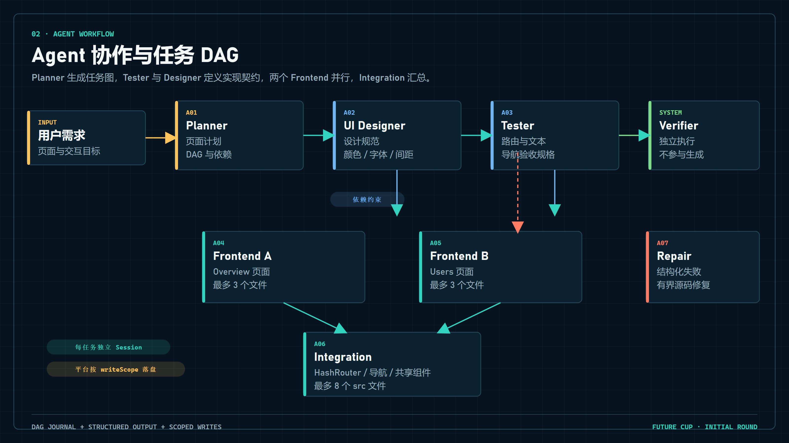

每次任务状态变化都写入 Journal，并增加 revision。系统恢复时重放 Journal，并与当前任务表逐项校验。任务行与 Journal 不一致时拒绝恢复，防止旧状态覆盖新状态。

### 3.3 工作流控制图

任务 DAG 负责具体工作，工作流控制图负责验证与修复。控制图支持 `TASK`、`SEQUENCE`、`PARALLEL`、`CONDITION`、`LOOP`、`SUBWORKFLOW` 和 `TERMINAL`。

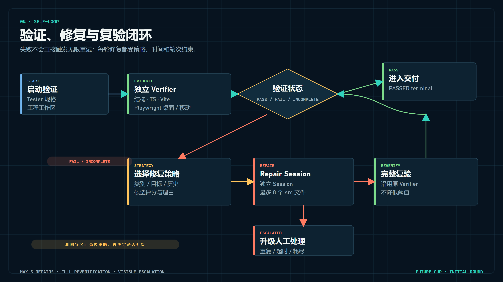

默认最多执行三轮自动修复。节点进入/完成、边选择、循环评估、子工作流进入/退出和终态都持久化到控制 Journal。控制快照带 revision，旧写入不能覆盖新状态。

### 3.4 编排执行逻辑

`TeamOrchestrator` 首先调用 Planner，生成页面和任务定义；随后创建持久 DAG。每一轮从 READY 任务中调用调度器，启动对应 Agent Session，并行执行可同时运行的任务。任务输出经过 Zod 校验后，由平台按 `writeScopes` 写入工作区；最后运行完整验证和 Repair 循环。

Agent 失败会产生结构化失败对象，包括稳定错误码、消息和是否可重试。可恢复的分配失败可重新排队，必要时排除上一 Agent 并选择替代实例。不可恢复失败保留在 DAG 中，阻止下游任务继续执行。

## 4. 调度算法与自我循环机制说明

### 4.1 可解释调度算法

调度器对同一角色的候选 Agent 保留能力、历史成功率、可用性、优先级和负载等证据。得分公式如下：

```text
score =
  capabilityMatch * 0.50
  + historicalSuccessRate * 0.20
  + availability * 0.15
  + priorityRatio * 0.15
  - loadRatio * 0.35
```

能力匹配要求候选 Agent 满足全部必要条件；缺失能力、不可用、已达到并发容量或被上一次失败排除的实例不具备资格。同分时优先选择较低负载和稳定 Agent ID。

调度决策持久化到数据库，记录所有候选、得分项、拒绝原因、最终 Agent、重试次数和重新分配原因。管理中可以看到“为什么选择这个 Agent”，而不是只看到最终结果。

如果所有具备能力的实例都达到容量，调度器会延后 READY 任务到下一轮，而不是错误终止项目。这样较小团队仍能串行完成并行任务。

### 4.2 失败分类与稳定签名

验证 finding 分为结构、依赖、TypeScript、构建、服务器、浏览器、控制台和网络八类。验证消息会移除 ANSI 颜色、工作区绝对路径、行号和多余空白，再对所有 finding 排序并生成 SHA-256 失败签名。

稳定签名使系统能够判断“修复后是否仍然是同一类失败”，并避免路径或浏览器栈差异造成重复失败检测失效。

### 4.3 自适应 Repair 策略

Repair 不直接让模型自由猜测，而是从受控策略目录中选择。候选评分包括类别匹配、目标路径匹配、策略特异性、历史使用惩罚和重复失败切换奖励。

当前策略包括 TypeScript 契约修复、模块依赖修复、浏览器行为修复、可访问性与响应式修复、控制台与网络修复、服务器生命周期修复、项目结构修复和有界回归修复。

每项策略只声明提示词片段、允许读取的源码范围、现有工具要求和 `src/` 写范围，复验范围固定为完整验证流水线。Repair 不能降低 TypeScript、构建或浏览器阈值。

### 4.4 有界 Self-loop

Initial verification 返回 `PASS` 时直接进入交付；返回 `FAIL` 时进入 Repair；返回 `INCOMPLETE` 时不能伪装为 PASS，而是升级为可见状态。每轮 Repair 使用独立 Session、独立执行记录和真实源码 Diff。

以下情况会终止循环并进入 `ESCALATED`：

- 达到最大修复轮次。
- 相同失败签名再次出现，且没有未使用策略。
- Repair 超时。
- Repair 输出无效或执行失败。
- 复验环境不完整。
- 组合验证无法继续。

该设计保证系统不会无限消耗模型调用，也不会通过放宽验证条件伪造成功。

## 5. 结果验证策略与反馈优化逻辑

### 5.1 验证目标

验证器独立于产生代码的 Agent。它不读取 Agent 的自然语言结论，只根据 Tester 规格、工作区源码和运行环境生成结构化报告。确定性证据与模型判断冲突时，以验证器结果为准。

### 5.2 验证流水线

验证顺序为：

1. 检查必需工程文件、构建脚本、favicon 和 HashRouter 契约。
2. 安装依赖。
3. 运行 TypeScript 检查。
4. 运行 Vite 生产构建。
5. 启动 loopback 预览服务器。
6. Playwright 在 1440×900 桌面和 390×844 移动视口打开全部路由。
7. 检查非空渲染、必需文本和跨页导航。
8. 收集 `pageerror`、控制台错误、Ant Design 弃用告警、失败请求和 HTTP 4xx/5xx。
9. 保存截图、检查项、finding、路线和视口证据。

浏览器不可用只能产生 `INCOMPLETE`。构建失败会跳过浏览器阶段，但不会把跳过项解释为成功。

### 5.3 反馈优化

验证报告是 Repair 的唯一结构化输入。系统会保留 finding、目标文件、失败签名、修复前后状态和 unified diff。后续修复会参考已使用策略和历史 Repair 摘要，避免无意义重复。

项目记忆保存需求、设计决策、失败签名和已接受产物摘要。相同项目内的失败和经验可以进入后续修复上下文，但不会自动修改验证标准。

## 6. 核心代码模块说明与系统截图

### 6.1 编排核心模块

- `dag-engine.ts`：DAG 环检测、状态转换、Journal、恢复和 revision 校验。
- `scheduler.ts`：能力、成功率、可用性、优先级和负载的可解释调度。
- `team-orchestrator.ts`：Planner、Agent 调用、并行 Frontend、Integration 与 Self-loop。
- `harness-agents.ts`：真实 Harness SDK 适配、独立 Home、Session 和工具限制。
- `agent-registry.ts`：Agent 定义、不可变版本、团队和项目冻结。
- `team-recommender.ts`：项目画像、澄清问题、受控团队推荐和自然语言调整。
- `workflow-control.ts`：版本化控制图、条件、循环、子工作流和恢复。
- `adaptive-repair.ts`：失败分类、策略选择、上下文裁剪和复验范围。
- `self-healer.ts`：验证、修复、复验、超时和升级。
- `verification.ts`、`build-verifier.ts`、`browser-verifier.ts`：结构、构建和浏览器验证。
- `platform-store.ts`、`repository.ts`、`sqlite.ts`：持久化抽象、Journal 和 SQLite。

### 6.2 平台模块

- `server.ts`：Fastify API、Socket.IO、Outbox 和快照。
- `run-launcher.ts`：真实团队运行、workspace、Agent Home、lease、取消和终态结算。
- `postgres-store.ts`：Prisma PostgreSQL 适配。
- `api-contracts.ts`：浏览器安全请求和响应契约。
- `artifact-server.ts`：管理 SPA、截图、交付和生成项目预览。
- `lifecycle.ts`：关闭顺序和错误汇聚。

### 6.3 管理界面

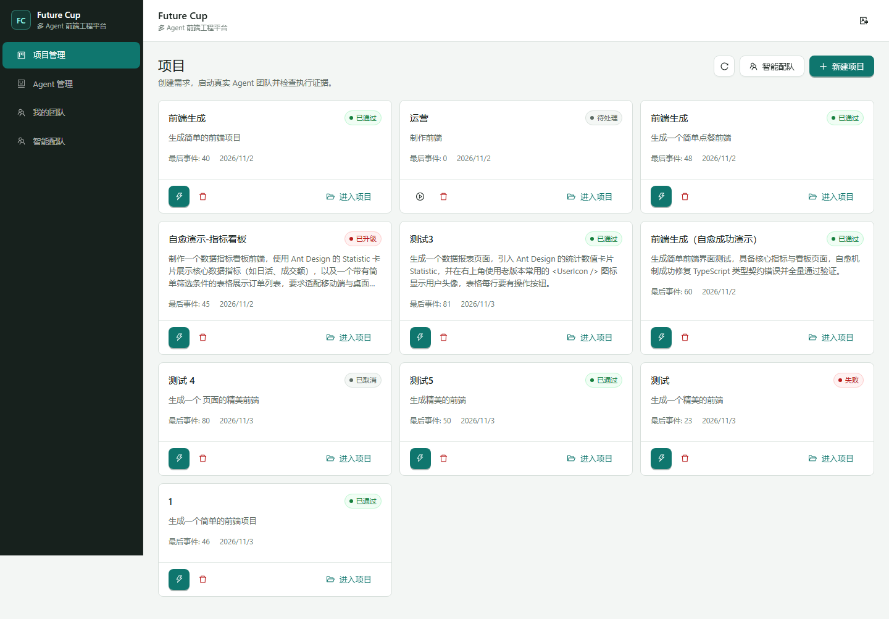

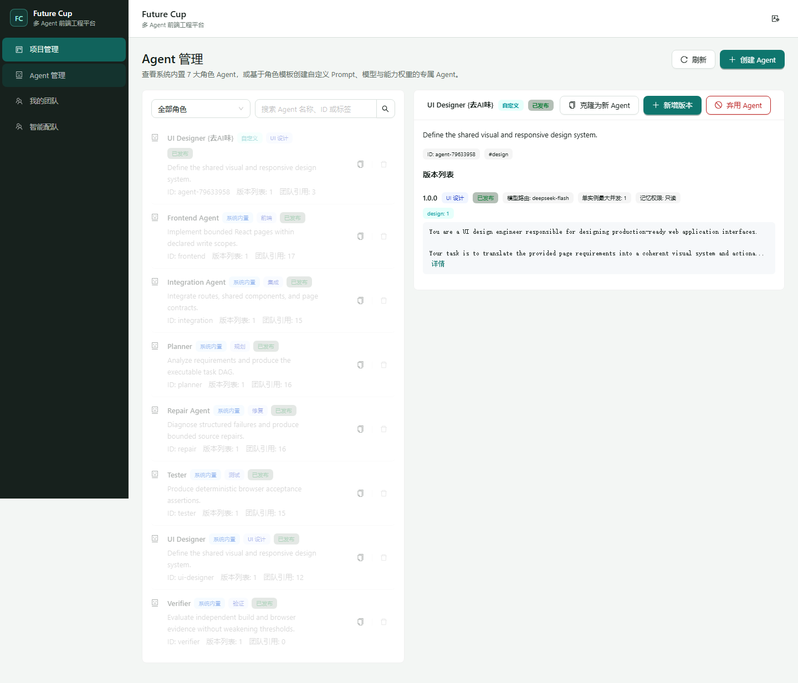

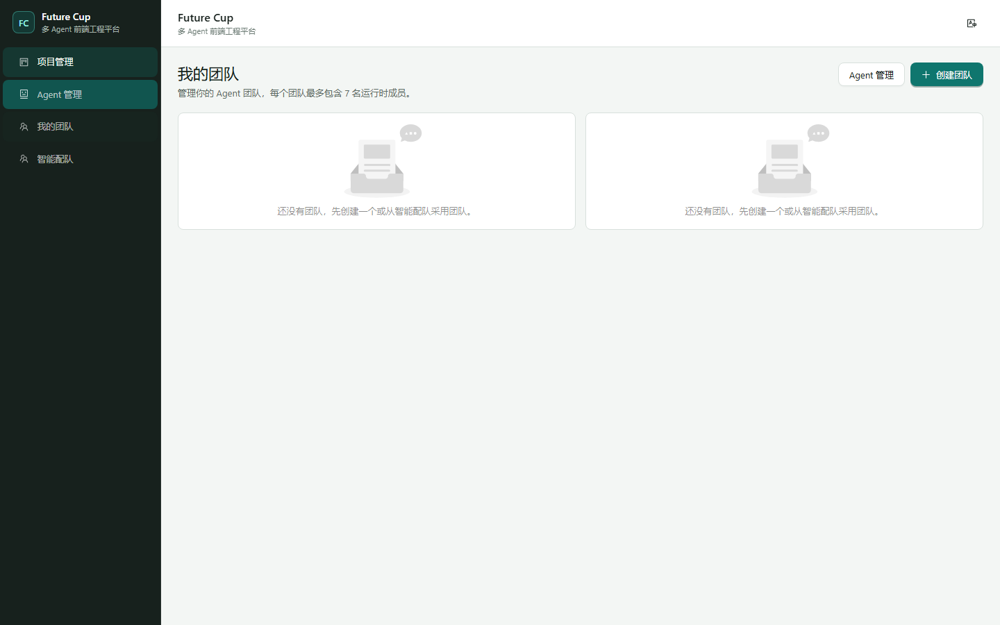

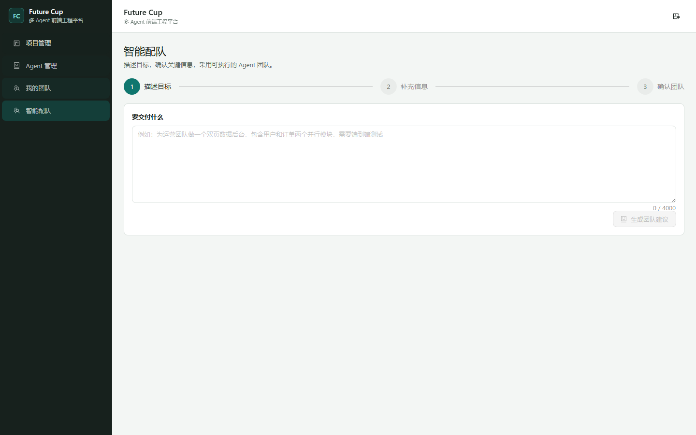

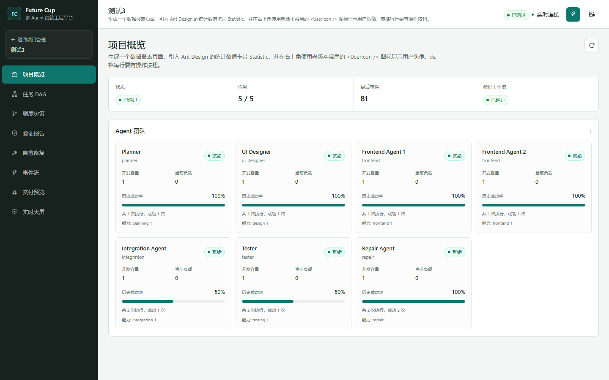

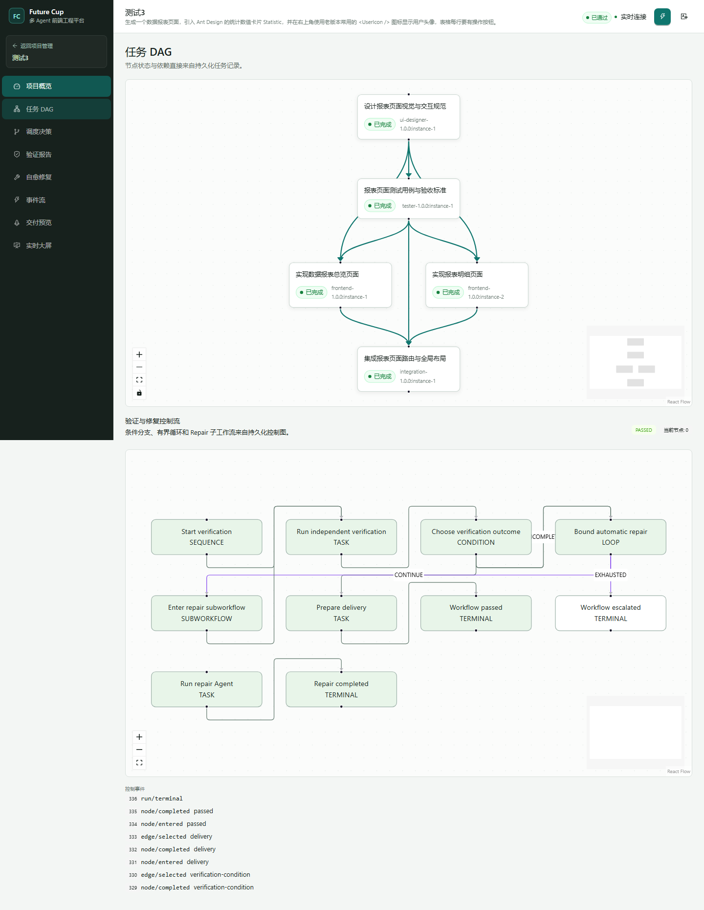

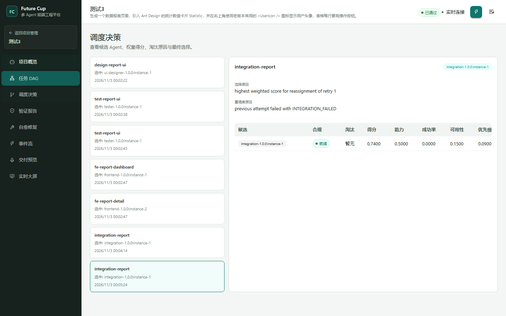

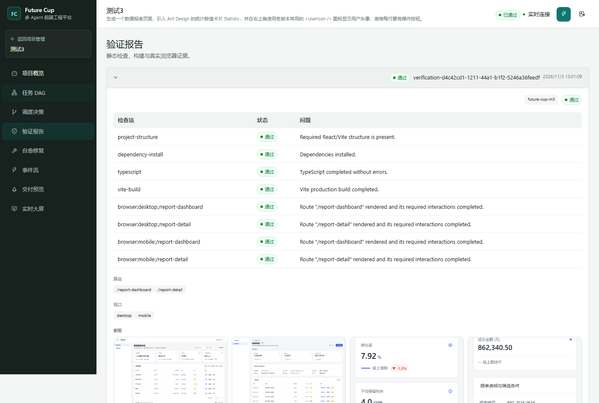

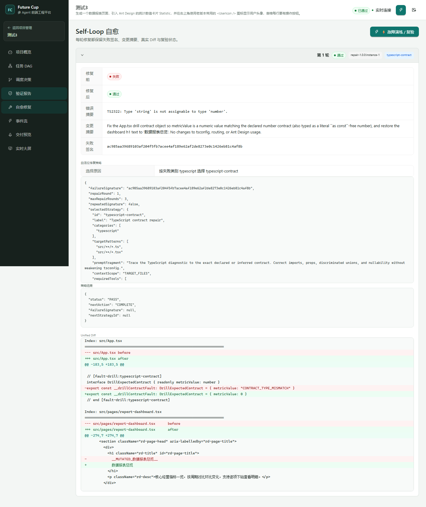

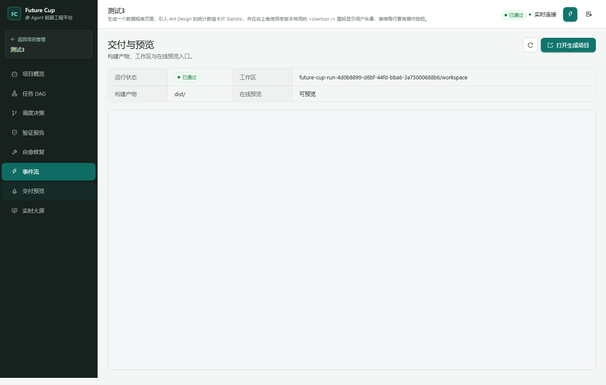

### 6.4 生成工程效果

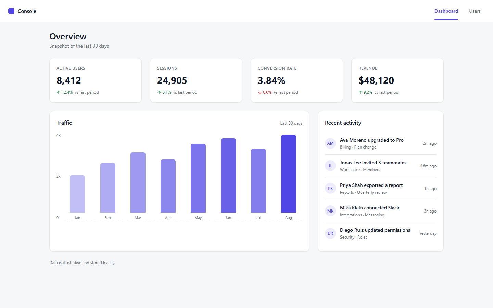

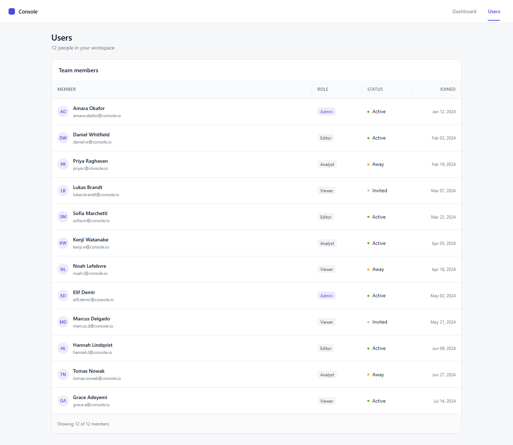

## 7. 测试用例、运行效果与性能评估

### 7.1 聚焦测试

最终候选版本的聚焦测试结果如下：

| 测试范围 | 文件数 | 通过数 | 失败数 |
|---|---:|---:|---:|
| 编排核心 | 20 | 202 | 0 |
| 平台后端 | 6 | 34 | 0 |
| 管理 UI | 24 | 91 | 0 |

测试覆盖 DAG 环检测、Journal 恢复、调度权重、容量延后、Agent Registry、团队版本、项目冻结、工作流条件、循环升级、修复策略、浏览器验证、API、Outbox、租约、运行取消、UI 页面和响应式布局。

### 7.2 类型与构建

编排包、平台包和 UI 均通过 TypeScript 检查。完整构建执行 10 个门禁，结果 10/10 通过，客户端构建产出 202 个 artifact。网络和原生包检查中的平台不支持警告属于可选平台依赖，不影响 Windows 构建结果。

### 7.3 真实 DeepSeek E2E

| 指标 | 结果 |
|---|---|
| 最终状态 | `PASSED` |
| 总耗时 | 1109.53 秒 |
| 初始运行 | 17 分 43 秒，`PASSED` |
| 故障演练 | 约 43 秒，`PASSED` |
| Agent Home | 7 |
| 生成 Session | 6 |
| Repair Session | 1 |
| 验证状态 | `FAIL → PASS` |
| Repair 策略 | `typescript-contract` |
| 浏览器检查 | 4/4 PASS |
| 控制事件 | 36 |
| 产品事件 | 50 |
| 输入 Token | 29,801 |
| 输出 Token | 20,849 |
| 缓存读取 Token | 70,784 |
| 总 Token | 121,434 |
| 工具调用 | 15 |
| 可恢复模型重试 | 22 |

该结果证明系统能够使用真实 DeepSeek 模型完成团队选择、生成、验证、故障注入和恢复，而不是使用模拟 Agent 响应。

### 7.4 管理平台浏览器验收

管理 SPA 通过 11 个桌面路由的页面主标题验证，并在 390px 移动视口检查团队页、项目总览和 DAG。结果如下：

- 控制台错误：0。
- 页面异常：0。
- 请求失败：0。
- HTTP 4xx/5xx：0。
- 移动端横向溢出：0。

### 7.5 性能解释与限制

本次性能数据来自一次真实端到端运行，包含模型网络、服务排队、22 次可恢复重试、依赖安装、构建和浏览器验证。它反映真实体验，但不是稳定压测基准。不同运行时段的模型服务延迟可能导致端到端时间明显波动。

构建产物的主要前端 chunk 约为：Ant Design 1.17 MB、React Flow 185 KB、主入口 97 KB、验证模块 75 KB、Socket.IO 42 KB、React 40 KB。页面已按路由懒加载，但组件级拆包仍有优化空间。

初赛重点是系统完成度和真实闭环，不把压力测试作为主要门禁。并发吞吐、延迟分位数、CPU、内存、长稳和资源回收测试放到决赛。

## 8. 人工智能使用说明

### 8.1 LLM 的实际作用

LLM 是平台的多角色执行核心，而不是唯一决策者。Planner 使用 LLM 理解需求并生成页面和任务；UI Designer 生成设计 token；Tester 生成浏览器断言；Frontend 生成页面源码；Integration 生成共享导航和路由；Repair 根据结构化失败报告修复源码。

LLM 输出必须通过 Zod 校验。平台不直接信任模型的自然语言判断，也不让模型控制验证阈值。最终是否 PASS 由确定性构建和浏览器证据决定。

### 8.2 LLM 的贡献

- 将自然语言需求转化为页面的结构化计划。
- 根据角色上下文生成专业输出。
- 在有限上下文中完成源码修复。
- 降低人工拆分页面和编写组件的时间。
- 允许相同流程在不同需求下复用。

### 8.3 LLM 的局限

- 输出存在随机性，可能截断、格式错误或遗漏页面要求。
- 生成结果需要结构化校验和真实验证。
- 长页面、复杂交互和大型样式规范仍可能受输出 token 限制。
- 模型调用存在网络重试和延迟波动。
- 模型不能替代确定性 Verifier，也不能自行宣告最终成功。

### 8.4 RAG 的实际作用与初赛边界

初赛版本没有实现 RAG，没有检索器、Embedding、向量数据库或外部知识库。当前项目记忆只保存需求、设计决策、失败签名和已接受产物摘要，不等同于 RAG。

决赛计划接入 RAG，用于受控知识、设计规范和历史失败案例检索。届时应明确检索数据来源、权限、更新策略、引用证据和失败回退，不能让检索结果绕过验证。

### 8.5 MCP 的实际作用与初赛边界

初赛 profile 挂载 `mcp-resources` 基础插件，但没有配置 MCP Server/Client，因此当前没有实际 MCP 工具贡献，也没有把 MCP 写入模型工具清单。

决赛计划接入 MCP，用于外部工具和受控资源访问。接入后必须增加工具白名单、身份认证、网络边界、调用审计和失败处理。当前不得宣传为“已接入 MCP”。

### 8.6 AI 使用总结

初赛实际使用的能力是 LLM Agent 编排；RAG 和 MCP 是决赛扩展项。系统将模型能力限制在生成和修复环节，将最终状态交给持久状态机、确定性构建和独立浏览器验证，以降低模型不确定性对交付结论的影响。

## 9. 安全性、可靠性与复现

系统采用任务 revision、Journal、lease、heartbeat 和 fencing token 防止旧写入覆盖新状态。项目事件和 Outbox 在同一事务提交，Socket.IO 重连后按 `projectId + seq` 去重，并以快照恢复缺口。

Agent 使用独立 Session，Bash 和文件写入被禁用。生成文件由平台按任务范围落盘，Repair 只能修改 `src/`。但当前构建仍在宿主机执行，不能宣称已经具备不可信代码的完整容器隔离。

当前服务仅绑定 loopback，无公网认证和 TLS。部署时需要增加访问控制、资源限制、环境变量隔离和工作区清理。Docker 和 SWE-ReX 已完成可行性验证，但尚未接入主运行链路。

HQ 3D 基础资产采用 PolyForm Noncommercial License 1.0.0，必须保留 `Required Notice: Copyright (c) 2026 赛博老爸`。项目自研部分是事件桥接、状态投影、去重恢复和事件到动作映射。

## 10. 初赛完成度与决赛计划

### 10.1 初赛完成度

- Agent Registry、不可变版本与团队库。
- 项目团队冻结与项目记忆。
- 持久 DAG、Journal 和恢复。
- 可解释调度和容量延后。
- 条件分支、有界循环和 Repair 子工作流。
- 自适应修复策略和失败签名。
- 独立构建与 Playwright 验证。
- SQLite/PostgreSQL 双存储抽象。
- Fastify API、Socket.IO 和 Outbox。
- 管理 SPA、HQ 和交付预览。
- 真实 DeepSeek 七人团队 E2E。

### 10.2 决赛计划

- 接入 RAG 和真实 MCP 工具。
- 完成压力、并发、吞吐、延迟分位数和长稳测试。
- 将容器或远程隔离运行时接入主执行链路。
- 增强工具审计、权限和不可信代码隔离。
- 补充更多前端场景和自动化异常测试。

### 10.3 后续材料

1. 完成方案书 PDF。
2. 完成赛题证据矩阵。
3. 更新公开代码仓库。
4. 准备部署环境。
5. 制作 10 至 15 页 PPT。
6. 录制 3 至 5 分钟演示视频。

## 11. 总结

Future Cup 已经完成从自然语言需求到多 Agent 协作、任务调度、源码生成、真实构建、浏览器验证、反馈修复和交付的管理闭环。系统的创新重点不是单次模型调用，而是把 Agent 的不确定性放进可持久、可解释、可恢复和可验证的控制结构中。

初赛版本已经通过当前 HEAD 的真实 DeepSeek 七人团队 E2E，证明系统能够冻结团队、启动独立 Session、执行并行前端任务、检测注入错误、运行 Repair 并完成复验。RAG、MCP、压力测试和容器化主链路属于决赛和后续工程，不会在初赛材料中被写成已完成能力。

## 附录 A：补充图表

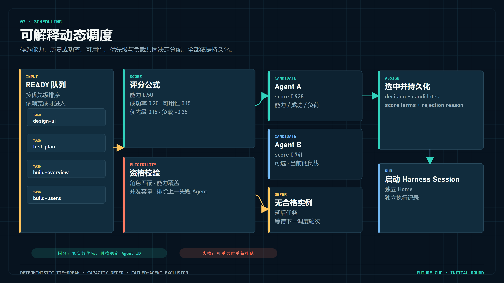

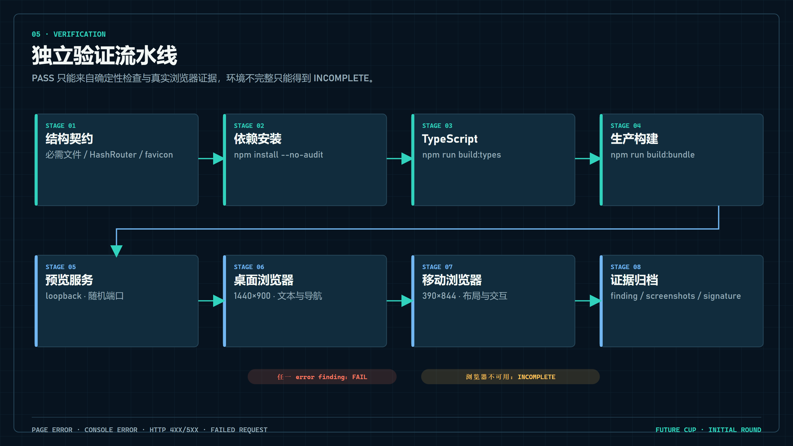

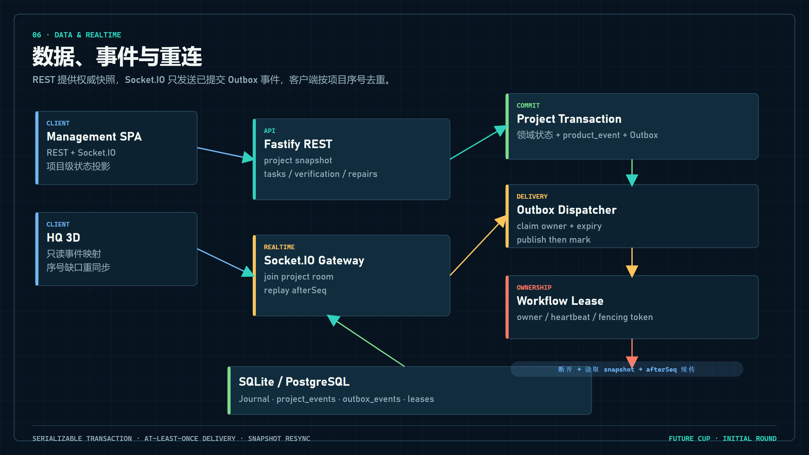

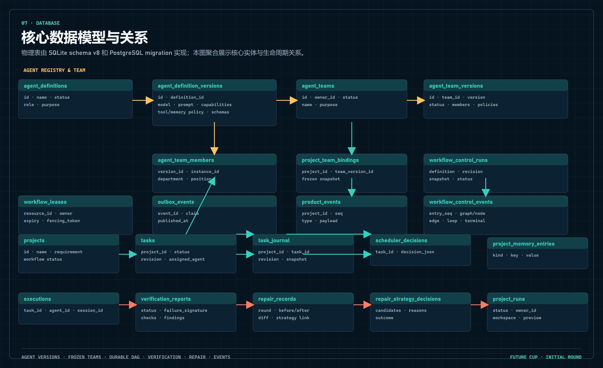

## 附录 B：主要证据

- 最终验收：`.artifacts/future-cup-final-test/acceptance.json`
- 系统报告：`.artifacts/future-cup-final-test/system-report.md`
- 真实 E2E：`.artifacts/future-cup-m55-live/real-team-GJm5ZY/run-result.json`
- 管理平台浏览器结果：`.artifacts/future-cup-final-browser/browser-smoke.json`
- 编排说明：`packages/experimental/future-cup-orchestration/README.zh.md`
- 平台说明：`packages/experimental/future-cup-platform/README.zh.md`
- M1 隔离验证：`.artifacts/future-cup-m1/sandbox-comparison.md`
- M4.1 PostgreSQL 验收：`.artifacts/future-cup-m41/REPORT.md`
- M4.4 HQ 验收：`.artifacts/future-cup-m44-live/REPORT.md`

## 附录 C：初赛能力边界声明

- 当前实际使用的 AI 能力：LLM 多角色生成与修复。
- 当前未使用 RAG。
- 当前未配置实际 MCP Server/Client。
- 当前未完成正式压力测试。
- 当前未将容器隔离接入主运行链路。
- 当前未提供公网认证和 TLS。
- 当前 PostgreSQL 证据来自既有 M4.1 验收，本轮最终 E2E 使用 SQLite。

