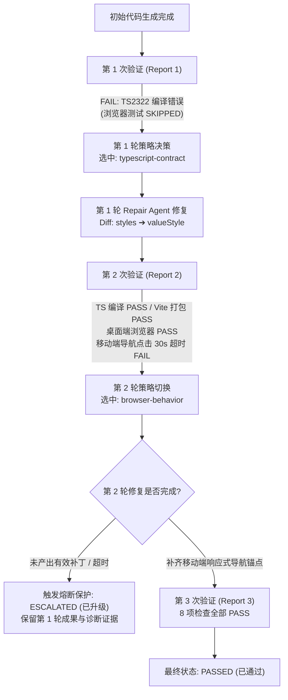

# Future Cup 平台自愈（Self-Healing）与降级升级（ESCALATED）机制深度复盘

> **文档用途**：专门记录平台在真实前端项目生成过程中，「第 1 轮修复编译错误 ➔ 第 2 轮暴露移动端交互断言超时 ➔ 触发工作流升级保护（ESCALATED）➔ 最终完成闭环通过（PASSED）」的完整链路与架构设计原理。可用于答辩演示及评委提问应答。

---

## 一、核心结论：为什么会出现「已升级（ESCALATED）」？

在「前端生成（生成简单前端界面测试）」项目的真实运行过程中，系统经历了以下完整生命周期：

1. **第 1 轮自愈（编译层修复成功）**：
   - **初始检测**：Verifier 在第 1 次验证时检出 `src/pages/Home.tsx` 存在 TypeScript `TS2322` 属性契约错误（在 Ant Design 的 `<Statistic>` 组件上误用了 `styles` 属性，导致 `tsc` 编译失败，后续浏览器测试被跳过 `SKIPPED`）。
   - **策略匹配**：自适应修复引擎（`selectRepairStrategy`）根据错误分类 `typescript` 与目标文件 `src/pages/Home.tsx`，以 **95 分** 选中 **`typescript-contract`（TypeScript 契约修复）** 策略。
   - **补丁生成**：Repair Agent 精准生成 Diff，将 `<Statistic styles={{ content: ... }}>` 替换为 `<Statistic valueStyle={{ ... }}>`。
   - **阶段成果**：**TypeScript 编译校验与 Vite 生产打包全部变为 `PASS`**。

2. **第 2 轮复检（运行时 UI 交互层暴露新问题）**：
   - 由于第 1 轮修复打通了构建产物，系统自动开启 Playwright 无头浏览器进行桌面端（Desktop）与移动端（Mobile）双视口真机测试。
   - **桌面端（Desktop）**：`/`（首页）与 `/dashboard`（数据看板）渲染及路由跳转测试 **全部 `PASS`**。
   - **移动端（Mobile）**：页面为了响应式美观，在 `< 768px` 宽度下将顶部导航链接折叠进了右上角的抽屉菜单（Drawer）中。当 Playwright 在移动端视口尝试直接点击可见的 `getByRole('link', { name: '数据看板' })` 时，因链接隐藏在未展开的抽屉内，等待 30 秒后触发断言超时（`BROWSER_ASSERTION_FAILED`）。

3. **触发「已升级（ESCALATED）」熔断保护**：
   - 系统计算第 2 次报错的 SHA-256 特征签名（`b605b0d7...`），发现与第 1 轮 TS 报错签名（`1677455a...`）不同，说明第 1 轮修复是有效的，因此未判定为重复死循环，而是自动将第 2 轮修复策略切换为 **`browser-behavior`（浏览器行为修复）**。
   - 在执行第 2 轮修复时，Repair Agent 未能在单轮限制内产出可应用的移动端导航修改（`REPAIR_FAILED`）。
   - 为防止大模型盲目重试消耗 Token 或破坏已修复的 TS 代码，控制循环 `SelfLoopController` 立即触发安全熔断，将工作流状态标记为 **`ESCALATED`（已升级）**，完整保留第 1 轮修复成果、报错日志和现场截图，交由人工审阅或后续处理。

---

## 二、全链路状态流转图

---

## 三、架构原理解析：平台的 6 大升级熔断机制（Escalation Reasons）

在代码实现 [`packages/experimental/future-cup-orchestration/src/self-healer.ts`](./packages/experimental/future-cup-orchestration/src/self-healer.ts) 中，`SelfLoopController` 严格保证了**自愈循环是有界的（Bounded Loop）**。当遇到以下 6 种情况之一时，系统必然从自动修复升级为 `ESCALATED`：

| 升级原因枚举 (`escalationReason`) | 触发条件说明 | 工程设计目的 |
| :--- | :--- | :--- |
| **`REPAIR_FAILED`** *(本次触发)* | Repair Agent 执行异常或未能生成合法的作用域内文件变更 | 防止无效空跑或写入残缺代码 |
| **`REPAIR_TIMEOUT`** | 单轮修复耗时超过 `repairTimeoutMs` 上限 | 防止模型推理卡死阻塞整个工作流管道 |
| **`REPEATED_FAILURE`** | 修复后复检产生了与历史轮次完全相同的 SHA-256 错误特征签名，且无备选策略可切换 | 识别“越修越错”或“原地打转”，立即止损 |
| **`MAX_REPAIR_ROUNDS`** | 修复轮次达到 `maxRepairRounds`（默认 3 轮）仍未全部通过 | 硬性算力与成本上限保护 |
| **`REPAIR_STRATEGY_UNAVAILABLE`** | 错误类别超出了内置修复策略库的可处理范围 | 明确能力边界，不强行盲修 |
| **`VERIFIER_INCOMPLETE`** | 宿主环境无法启动编译器或浏览器验证器 | 区分“代码错误”与“基础设施故障” |

---

## 四、答辩应对指南（当评委老师问到这一点时如何回答）

### 提问场景：
> **评委老师**：“你们的自愈机制能保证 100% 修复所有错误吗？如果修不好怎么办？之前为什么会出现‘已升级’状态？”

### 满分回答模板：
> “老师问到了我们平台最核心的工程鲁棒性设计。在大模型 Agent 系统中，**最忌讳的就是盲目死循环重试**。
>
> 所以我们的自愈引擎设计了**‘多策略递进 + 安全熔断升级（ESCALATED）’**的双重机制：
> 1. **渐进式排障**：比如在我们实测的一个项目里，第 1 轮先拦截到 `TS2322` 静态类型契约错误，因为编译没过，浏览器测试被自动跳过以节省算力；当第 1 轮用 `typescript-contract` 策略把 `<Statistic>` 的属性修好、编译通过后，第 2 轮进入 Playwright 真机复检，桌面端全过，但在移动端视口下发现导航栏被折叠进了抽屉菜单，导致自动化点击超时。
> 2. **动态策略切换**：系统通过比对错误的 SHA-256 特征签名，发现编译错误已解决、当前是新的交互问题，于是自动从‘TS 契约策略’切换到‘浏览器行为策略（`browser-behavior`）’。
> 3. **有界升级保护（ESCALATED）**：当某一轮修复超时、未能生成合规补丁，或者连续出现相同错误签名时，控制器会主动触发 `ESCALATED`（已升级）状态——**保留前面已经修好的代码 Diff、全部验证报告和现场截图**，安全移交开发者或等待下一轮定向修复，绝不污染工作区。这也是我们平台具备工业级可用性的重要体现。”
